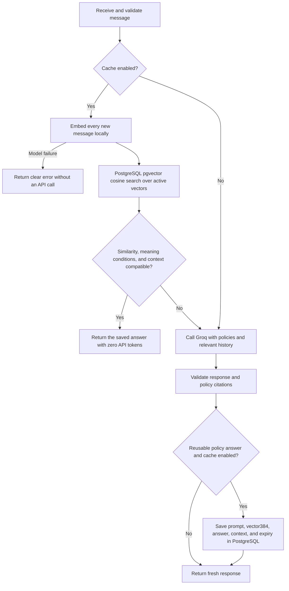

# Semantic cache request flow

- No predefined question list or topic-keyword requirement controls embedding lookup.
- Every cache-enabled question is compared, including follow-ups and first-person wording.
- Complete questions can share answers within the same chat; referring follow-ups require matching history.
- Numbers and explicit conditions are checked because opposite questions can have high cosine similarity.
- A failed embedding never silently spends model tokens.
- Scope, similarity, and model decisions remain imperfect; inspect real queries before production use.

PostgreSQL runs through `compose.yaml` with a persistent Docker volume. Similarity is computed by pgvector in SQL; Python receives the best compatible answer and diagnostics. Time units and normalized number wording are also checked.
